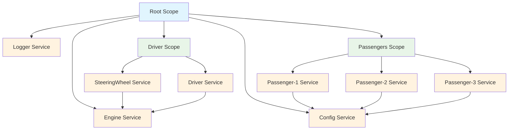

# Scopes

A scope in `doger` is a module of an application with restricted visibility: it groups related services and can see services from its ancestor scopes, but not from its siblings. We advocate having a `RootScope` for common code and moving business logic to dedicated `Scopes`.

Scopes are structured with a parent (the root scope or another scope), numerous services, and potentially a few child scopes as well.

The `RootScope` owns options and is the only scope that supports cloning.

Services from a scope can invoke services available locally or in ancestor scopes. Therefore, a single service can be instantiated many times in different branches of the scope tree without conflict.

A chain of service invocations instantiates multiple virtual scopes to track dependency cycles.

Scopes are almost invisible to developers: services use the Injector API without awareness of whether the underlying implementation is a root scope, a regular scope, or an internal virtual scope used for dependency tracking.

The `doger.Injector` interface is implemented by `*doger.RootScope` and `*doger.Scope`. `*doger.virtualScope` are internal implementation details.



## New scope {#new-scope}

A root scope is created when calling `doger.New()`. Multiple layers of child scopes can be added. Each nested scope shares the same root scope.

```go
// root scope
injector := doger.New()

// nested scopes
driverModule := injector.Scope("driver")
passengersModule := injector.Scope("passengers")
```

Then, inject services into respective scopes. Some services can depend on parent services.

```go
// inject services to root scope
doger.Provide(injector, NewEngine)

// inject *SteeringWheel service to "driver" scope
doger.Provide(driverModule, func(i doger.Injector) (*SteeringWheel, error) {
    return &SteeringWheel{
        // invoke *Engine service from parent scope
        Engine: doger.MustInvoke[*Engine](i),
    }, nil
})

// inject many *Passenger services to "passengers" scope
doger.ProvideNamed(passengersModule, "passenger-1", func(i doger.Injector) (*Passenger, error) {
    return &Passenger{ ... }, nil
})
doger.ProvideNamed(passengersModule, "passenger-2", func(i doger.Injector) (*Passenger, error) {
    return &Passenger{ ... }, nil
})
doger.ProvideNamed(passengersModule, "passenger-3", func(i doger.Injector) (*Passenger, error) {
    return &Passenger{ ... }, nil
})
```

At this step, services have not been instantiated. Let's invoke them:

```go
// instantiate *SteeringWheel and *Engine
svc := doger.MustInvoke[*SteeringWheel](driverModule)

// instantiate passengers
svc := doger.MustInvokeNamed[*Passenger](passengersModule, "passenger-1")
svc := doger.MustInvokeNamed[*Passenger](passengersModule, "passenger-2")
svc := doger.MustInvokeNamed[*Passenger](passengersModule, "passenger-3")
```

**Play: https://go.dev/play/p/vwLEbyo0APp**

## Scope export {#scope-export}

A child scope hides its services from its parent: lookup only walks up the tree. `doger.Export` publishes selected services of a child scope to its parent, and keeps every other service private.

```go
injector := doger.New()
redis := injector.Scope("redis")

doger.Provide(redis, NewPool)   // private to "redis"
doger.Provide(redis, NewClient) // depends on *Pool

// publish *Client in the root scope, under the same name
doger.MustExport[*Client](redis)

client := doger.MustInvoke[*Client](injector)
```

The child keeps ownership of the exported instance: it is built, started, health-checked and shut down exactly once, by the child. The export itself is an alias bound to the child scope (listed as `alias`): it is never started or shut down, and it always resolves from the child, whatever scope invokes it.

`ExportNamed` exports a named service, and `doger.ExportAs("name")` publishes it under another name, for example when two child scopes export the same type. An export reaches the direct parent only; to publish further up, export it again from the parent:

```go
a := injector.Scope("a")
b := a.Scope("b")
doger.Provide(b, NewClient)
doger.MustExport[*Client](b) // into "a"
doger.MustExport[*Client](a) // into the root
```

`Export` returns an error, and registers nothing, when the scope is nil or has no parent, when the service is not registered in that scope itself (a service it only sees through an ancestor cannot be exported), when its type is not assignable to `T`, or when the published name is empty or already registered in the parent. `MustExport` and `MustExportNamed` panic with that error. Invoking an export after its scope was shut down fails with `ErrServiceNotFound`.

### Ownership {#scope-export-ownership}

- **Start:** the child starts the exported `Starter`, once. A parent `Starter` that depends on the export starts after it.
- **Health check:** a health check of the parent runs the exported service's check under the published name. A health check of the child itself reports it once, under its own name.
- **Shutdown:** only the child shuts the exported service down. Shutting the export down (`ShutdownNamed` on the published name) removes it without touching the service.
- **Clone:** a cloned container's export resolves from the cloned child scope, never from the original.

### Collections {#scope-export-collections}

Unlike `As` and `Bind` aliases, an export is a member of collections (`InvokeAll`, `InvokeAllMap`, live collections) read from the parent and its other descendants, since the exported service is not visible there otherwise. Read from the exporting scope or its descendants, the export is left out and the service is counted once, under its own name. `InvokeAs` in the parent finds the export too.

### Exporting a default {#scope-export-defaults}

Exporting a service registered with `AsDefault()` publishes a default: an explicit service of the published name in the parent wins, before or after the export. See [Exporting a default](../service-registration/default-registrations.md#export).

### Shutdown order {#scope-export-shutdown}

When the parent shuts down, its services that depend on an export shut down **before** the exporting child, so they never see the exported service closed:

1. the child scopes that export nothing, in parallel, as before;
2. the parent's services with a dependency path to an export, in dependency order;
3. the exporting child scopes, in parallel;
4. the parent's other services.

An exporting child therefore runs its `HookScopeClosing` and `HookScopeClosed` hooks inside its parent's pair. Scopes without exports shut down exactly as before.

### Defaults & control {#scope-export-control}

| Behavior                      | Zero-config default                                                         | Consumer control                                                                                     |
| ----------------------------- | --------------------------------------------------------------------------- | ---------------------------------------------------------------------------------------------------- |
| Name of the published service | The name of the child service                                               | `doger.ExportAs(name)`                                                                               |
| Lifecycle of the instance     | Owned by the child: started, health-checked and shut down there, once       | Not overridable: one owner per instance; to make the parent own a service, register it in the parent |
| Shutdown order                | The parent's dependents of the export shut down before the exporting child  | `DeclareDependency` and `DependsOn` add edges; nothing shuts the child down first                    |
| Scopes without exports        | Shutdown exactly as before                                                  | -                                                                                                    |
| Exporting a default           | The export is a default too: an explicit service of the published name wins | Register the explicit service, or export a non-default source to publish an explicit one             |
| Collections in the parent     | The export is a member                                                      | Read from the exporting scope, or invoke by name, to bypass it                                       |

## Debug {#debug}

A debugging toolchain has been added to illustrate the service [dependency](../troubleshooting/service-dependencies.md) chain and [scope tree](../troubleshooting/scope-tree.md).

## Examples {#examples}

See examples in the [project repository](https://github.com/kartaladev/doger).
