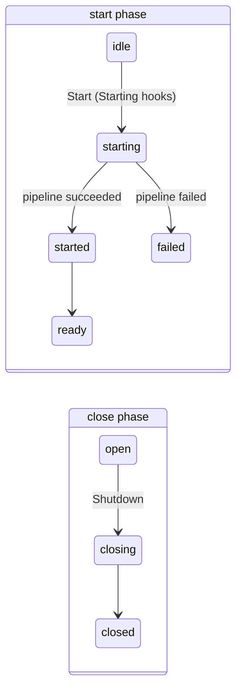

# Container hooks

Container hooks run container-wide logic once per root container: when it starts, when it is ready, when its start fails, and around its shutdown. They complement the per-service hooks (`HookBeforeStart`, `HookAfterShutdown`…), which run once per service.

| Hook                    | Signature                                            | Fires                                                |
| ----------------------- | ---------------------------------------------------- | ---------------------------------------------------- |
| `HookContainerStarting` | `func(context.Context, *RootScope) error`            | first `Start`, before anything is built              |
| `HookContainerStarted`  | `func(context.Context, *RootScope)`                  | first `Start`, once its pipeline succeeded           |
| `HookContainerReady`    | `func(context.Context, *RootScope)`                  | first `Start`, after every Started hook              |
| `HookContainerFailed`   | `func(context.Context, *RootScope, error)`           | first `Start`, when it fails                         |
| `HookContainerClosing`  | `func(context.Context, *RootScope)`                  | first root `Shutdown`, before any service shuts down |
| `HookContainerClosed`   | `func(context.Context, *RootScope, *ShutdownReport)` | first root `Shutdown`, after every service shut down |

Each hook list is a field of `doger.InjectorOpts`, and has a matching `RootScope.AddContainer<State>Hook` method, which ignores a nil hook. Register hooks at configuration time: the adders are not safe to call concurrently with `Start` or `Shutdown`. Each list is copied before it runs, so a hook added while a list runs applies from the next run of that list.

## Phases {#phases}

A root container has a start phase and a close phase. Each transition happens at most once, and the hooks fire at the transitions:



The two phases are independent: a container can shut down without ever starting, or while it is starting.

`root.Phase()` reports where the container is, as a `doger.ContainerPhase`. Once root `Shutdown` began, the close phase wins:

| `Phase()`       | `String()` | Meaning                                                 |
| --------------- | ---------- | ------------------------------------------------------- |
| `PhaseIdle`     | `idle`     | not started, not shut down                              |
| `PhaseStarting` | `starting` | the first `Start` is running (Starting hooks, pipeline) |
| `PhaseStarted`  | `started`  | `Start` succeeded; the Started hooks are running        |
| `PhaseReady`    | `ready`    | the Started hooks returned; Ready hooks and later       |
| `PhaseFailed`   | `failed`   | the first `Start` failed                                |
| `PhaseClosing`  | `closing`  | root `Shutdown` is running (Closing hooks, services)    |
| `PhaseClosed`   | `closed`   | root `Shutdown` completed                               |

A clone starts in `PhaseIdle`. Child scopes have no phase of their own. `Phase()` is safe to call from any goroutine, including from hooks.

## Starting {#starting}

`HookContainerStarting` hooks run on the goroutine that calls the first `Start`, after its one-shot guard and **before** its context check, discovery or any instantiation. They receive the Start-time context, which keeps the values of the context passed to `StartWithContext` and is cancelled by a root `Shutdown`.

A Starting hook can **veto** `Start` by returning an error: the remaining Starting hooks do not run, nothing is built or started, and `Start` returns an error wrapping the hook's error.

```go
root := doger.New()

root.AddContainerStartingHook(func(ctx context.Context, root *doger.RootScope) error {
    if os.Getenv("DB_URL") == "" {
        return errors.New("missing DB_URL") // fail fast: nothing is built
    }
    return nil
})

err := root.Start()
// err: DI: container start aborted: missing DB_URL
```

Because Starting hooks run before the context check, they run even when the context passed to `StartWithContext` is already cancelled. `Start` then fails with an error matching `context.Canceled`.

## Started and Ready {#started-and-ready}

When the start pipeline succeeds, `Start` runs every `HookContainerStarted` hook, then every `HookContainerReady` hook, on the goroutine that called `Start`, and then returns nil. Both receive the context passed to `StartWithContext`.

- **Started** means "the pipeline succeeded". Use it for last wiring, such as registering routes or warming caches.
- **Ready** means "every Started hook has returned". Use it to signal readiness to an orchestrator.

Started fires **after** the runnables: the pipeline builds every candidate, starts the Starters, then runs the `StageAfterStart` handlers, including the built-in `Runnable` handler, and only then fires Started. For a Starter "server" and a Runnable "migrate", the order is:

```text
starting-hook, server.Start, migrate.Run, started-hook, ready-hook
```

Started and Ready also fire for a container with no services.

```go
root.AddContainerReadyHook(func(ctx context.Context, root *doger.RootScope) {
    readiness.Store(true) // the readiness probe now reports healthy
})
```

## Failed {#failed}

When the first `Start` fails after its one-shot guard, it runs every `HookContainerFailed` hook with the context passed to `StartWithContext` and the **exact error** it is about to return, then returns it. Started and Ready do not run. Failures include a Starting veto, a cancelled context, a provider, Starter, kind handler or runner error, and a `Shutdown` that began before the pipeline finished.

Guard errors fire no hook: a second `Start` (`ErrAlreadyStarted`) or a `Start` after `Shutdown` (`ErrStartAfterShutdown`) returns before any container hook runs.

`Start` rolls nothing back, so a Failed hook is a good place to clean up:

```go
root.AddContainerFailedHook(func(ctx context.Context, root *doger.RootScope, err error) {
    log.Printf("start failed: %v", err)
    root.Shutdown()
})
```

## Closing and Closed {#closing-and-closed}

The root `Shutdown` call that begins the close phase runs every `HookContainerClosing` hook before any service is shut down. Once every service is shut down and the close phase is closed, it runs every `HookContainerClosed` hook with the `*ShutdownReport` it returns. This holds whether or not `Start` ran or succeeded, and for `ShutdownOnSignals` and `ShutdownOnSignalsWithContext` too. Both receive the context passed to `ShutdownWithContext`.

```text
closing-hook, db.Shutdown, closed-hook
```

The Closed hook sees shutdown errors in the report. Do not mutate the report from a hook.

```go
root.AddContainerClosedHook(func(ctx context.Context, root *doger.RootScope, report *doger.ShutdownReport) {
    if !report.Succeed {
        log.Printf("shutdown errors: %v", report)
    }
})
```

For a start and a shutdown with all six hooks registered, the order is:

```text
starting, db started, started, ready, closing, db stopped, closed
```

## Calling Shutdown from a hook {#calling-shutdown-from-a-hook}

Started, Ready, Failed and Closed hooks run after the running `Start` or `Shutdown` was released, so they may call root `Shutdown()` synchronously:

- from Started, Ready or Failed, it shuts the container down; Closing and Closed fire once, on that call;
- from Closed, it returns a copy of the first report at once.

Starting and Closing hooks run while `Start` or `Shutdown` is still running. A root `Shutdown` called synchronously from them waits for that operation, which waits for the hook: it **deadlocks** unless its context has a deadline. With a deadline:

- from a Starting hook, `Shutdown` returns a failed report when the deadline expires, and `Start` then fails with an error matching `ErrStartAfterShutdown`;
- from a Closing hook, the nested `Shutdown` returns a failed report when the deadline expires, while the outer `Shutdown` completes normally.

Prefer returning an error from a Starting hook to veto `Start`.

## Shutdown during Start {#shutdown-during-start}

A root `Shutdown` that begins while the start pipeline runs cancels `Start` with cause `ErrStartAfterShutdown` and fires Closing only **after** the pipeline returned, or after its own context ended. `Start` then skips Started and Ready and runs Failed with an error matching `ErrStartAfterShutdown`, even if the pipeline returned nil.

Once the pipeline has returned, the hooks run on two goroutines:

- Started, Ready and Failed run on the goroutine that called `Start`;
- Closing and Closed run on the goroutine that called `Shutdown`.

So Closing and Closed may run **before or while** Started, Ready or Failed run. For example, a `Shutdown` that begins while a Started hook is running records `started-hook, closing-hook, closed-hook, ready-hook`. Hooks that share state across these points must synchronize it.

Concurrent `Shutdown` callers that wait for the first one are released once services are shut down, so they may return before the Closed hooks have run.

## Panics {#panics}

A panic in a Started, Ready, Failed, Closing or Closed hook is recovered. The remaining hooks of that list still run, and so does the rest of `Start` or `Shutdown`, including its phase transitions: services are still shut down, and waiters are released. Once the operation is complete, the **first** recovered panic is passed, on the calling goroutine, to `InjectorOpts.HookContainerPanic` with the hook point name (`started`, `ready`, `failed`, `closing` or `closed`). Later panics of the same operation are logged with `Logf`.

By default, `HookContainerPanic` is nil and the operation **re-panics** with the recovered value, like per-service hooks do. Set it to log instead, and `Start` or `Shutdown` returns its normal result:

```go
root := doger.NewWithOpts(&doger.InjectorOpts{
    HookContainerPanic: func(root *doger.RootScope, hook string, recovered any) {
        log.Printf("container %s hook panicked: %v", hook, recovered)
    },
})
```

A panic in a Starting hook is different: it is a **veto**. `Start` fails with an error containing the panic value, and `HookContainerPanic` is not called.

A panic in a per-service hook during `Start` (such as `HookBeforeStart`, `HookAfterStart` or `HookAfterBuild`) is not an observer hook panic: it is re-raised on the goroutine that called `Start`. Before that, `Start` marks the container failed and runs the Failed hooks with an error wrapping the panic value, so cleanup wired to Failed still happens. If a Failed hook panics then, the panic goes to `HookContainerPanic` when it is set, and is logged otherwise: the per-service hook's panic is the one re-raised.

## Root container only {#root-only}

Container hooks fire only for the `*doger.RootScope` methods `Start`, `StartWithContext`, `Shutdown`, `ShutdownWithContext` and `ShutdownOnSignals*`. These do not fire them:

- `Shutdown` on a child `*doger.Scope`, such as a request scope;
- a shutdown reached through the root's own `*doger.Scope`, for example the injector a provider receives, or `Component.Scope` of a root service.

With no container hooks registered, `Start` and `Shutdown` behave as they did before container hooks existed.

## Refresh and Scope.Start {#refresh-and-scope-start}

Container hooks fire at most once per container, for its first `Start` and its first root `Shutdown`. [`Refresh` and `Scope.Start`](./starter.md#refresh) fire **no** container hook: no Starting, Started, Ready or Failed hook runs for an incremental start, even when it fails. Per-service start hooks (`HookBeforeStart`, `HookAfterStart`) and kind handlers still run for the services they start.

## Scope hooks {#scope-hooks}

Scope hooks run logic when a **child** scope starts or shuts down, for example per-tenant setup and teardown. They are registered like container hooks, in `InjectorOpts` or with `RootScope.AddScope<State>Hook`, run in registration order, and ignore nil hooks.

| Hook                | Signature                             | Fires                                                                  |
| ------------------- | ------------------------------------- | ---------------------------------------------------------------------- |
| `HookScopeStarting` | `func(context.Context, *Scope) error` | `scope.Start()`, before anything starts; an error or a panic vetoes it |
| `HookScopeStarted`  | `func(context.Context, *Scope)`       | `scope.Start()`, once the scope's services started                     |
| `HookScopeClosing`  | `func(context.Context, *Scope)`       | the scope shuts down, after its children and before its services       |
| `HookScopeClosed`   | `func(context.Context, *Scope)`       | the scope shut down                                                    |

- Closing and Closed fire whether the child scope shuts down directly or as part of its parent's shutdown, children before their parent. A child scope shut down directly stays attached to its parent, so a later parent shutdown fires its hooks again.
- Sibling scopes shut down in parallel, so their hooks may run concurrently.
- The root's own scope never fires scope hooks: use container hooks for the root container. `Refresh` fires no scope hook for new child scopes; only an explicit `scope.Start()` does.
- Started does not fire when the scope, or one of its ancestors, is shutting down: `scope.Start()` then starts nothing and returns nil.
- A veto returns an error wrapping the hook's error and naming the scope: ``DI: scope `tenant` start aborted: ...``. A panic reads ``DI: scope `tenant` start aborted: DI: scope starting hook panicked: <value>``, wrapping the value when it is an error.
- A panic in a Started, Closing or Closed scope hook follows the [container panic policy](#panics): the operation completes, then the first panic goes to `HookContainerPanic` with the point `scope-started`, `scope-closing` or `scope-closed`, or is re-raised on the calling goroutine when `HookContainerPanic` is nil.

```go
root.AddScopeClosingHook(func(ctx context.Context, scope *doger.Scope) {
    log.Printf("tenant %s shutting down", scope.Name())
})
```
