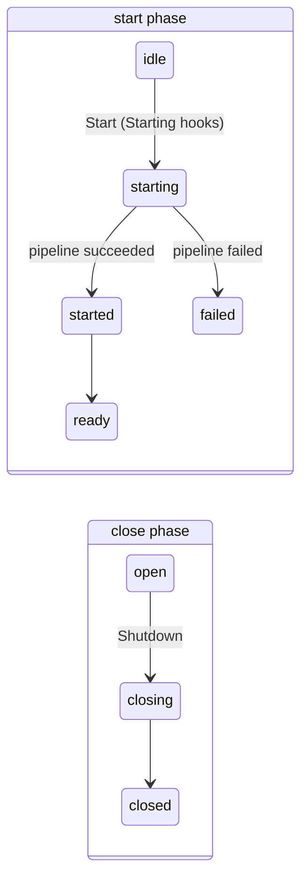

# Container hooks

Container hooks run container-wide logic once per root container: when it starts, when it is ready, when its start fails, and around its shutdown. They complement the per-service hooks (`HookBeforeStart`, `HookAfterShutdown`…), which run once per service.

| Hook                    | Signature                                            | Fires                                                |
| ----------------------- | ---------------------------------------------------- | ---------------------------------------------------- |
| `HookContainerStarting` | `func(context.Context, *RootScope) error`            | first `Start`, before anything is built              |
| `HookContainerStarted`  | `func(context.Context, *RootScope)`                  | first `Start`, once its pipeline succeeded           |
| `HookContainerReady`    | `func(context.Context, *RootScope)`                  | first `Start`, after every Started hook              |
| `HookContainerFailed`   | `func(context.Context, *RootScope, error)`           | first `Start`, when it fails                         |
| `HookContainerClosing`  | `func(context.Context, *RootScope)`                  | first root `Shutdown`, before any service shuts down |
| `HookContainerClosed`   | `func(context.Context, *RootScope, *ShutdownReport)` | first root `Shutdown`, after every service shut down |

Each hook list is a field of `doger.InjectorOpts`, and has a matching `RootScope.AddContainer<State>Hook` method.

## Phases {#phases}

A root container has a start phase and a close phase. Each transition happens at most once, and the hooks fire at the transitions:



The two phases are independent: a container can shut down without ever starting, or while it is starting.

## Starting {#starting}

`HookContainerStarting` hooks run on the goroutine that calls the first `Start`, after its one-shot guard and **before** its context check, discovery or any instantiation. They receive the Start-time context, which keeps the values of the context passed to `StartWithContext` and is cancelled by a root `Shutdown`.

A Starting hook can **veto** `Start` by returning an error: the remaining Starting hooks do not run, nothing is built or started, and `Start` returns an error wrapping the hook's error.

```go
root := doger.New()

root.AddContainerStartingHook(func(ctx context.Context, root *doger.RootScope) error {
    if os.Getenv("DB_URL") == "" {
        return errors.New("missing DB_URL") // fail fast: nothing is built
    }
    return nil
})

err := root.Start()
// err: DI: container start aborted: missing DB_URL
```

Because Starting hooks run before the context check, they run even when the context passed to `StartWithContext` is already cancelled. `Start` then fails with an error matching `context.Canceled`.

## Started and Ready {#started-and-ready}

When the start pipeline succeeds, `Start` runs every `HookContainerStarted` hook, then every `HookContainerReady` hook, on the goroutine that called `Start`, and then returns nil. Both receive the context passed to `StartWithContext`.

- **Started** means "the pipeline succeeded". Use it for last wiring, such as registering routes or warming caches.
- **Ready** means "every Started hook has returned". Use it to signal readiness to an orchestrator.

Started fires **after** the runnables: the pipeline builds every candidate, starts the Starters, then runs the `StageAfterStart` handlers, including the built-in `Runnable` handler, and only then fires Started. For a Starter "server" and a Runnable "migrate", the order is:

```text
starting-hook, server.Start, migrate.Run, started-hook, ready-hook
```

Started and Ready also fire for a container with no services.

```go
root.AddContainerReadyHook(func(ctx context.Context, root *doger.RootScope) {
    readiness.Store(true) // the readiness probe now reports healthy
})
```

## Failed {#failed}

When the first `Start` fails after its one-shot guard, it runs every `HookContainerFailed` hook with the context passed to `StartWithContext` and the **exact error** it is about to return, then returns it. Started and Ready do not run. Failures include a Starting veto, a cancelled context, a provider, Starter, kind handler or runner error, and a `Shutdown` that began before the pipeline finished.

Guard errors fire no hook: a second `Start` (`ErrAlreadyStarted`) or a `Start` after `Shutdown` (`ErrStartAfterShutdown`) returns before any container hook runs.

`Start` rolls nothing back, so a Failed hook is a good place to clean up:

```go
root.AddContainerFailedHook(func(ctx context.Context, root *doger.RootScope, err error) {
    log.Printf("start failed: %v", err)
    root.Shutdown()
})
```

## Closing and Closed {#closing-and-closed}

The root `Shutdown` call that begins the close phase runs every `HookContainerClosing` hook before any service is shut down. Once every service is shut down and the close phase is closed, it runs every `HookContainerClosed` hook with the `*ShutdownReport` it returns. This holds whether or not `Start` ran or succeeded, and for `ShutdownOnSignals` and `ShutdownOnSignalsWithContext` too. Both receive the context passed to `ShutdownWithContext`.

```text
closing-hook, db.Shutdown, closed-hook
```

The Closed hook sees shutdown errors in the report. Do not mutate the report from a hook.

```go
root.AddContainerClosedHook(func(ctx context.Context, root *doger.RootScope, report *doger.ShutdownReport) {
    if !report.Succeed {
        log.Printf("shutdown errors: %v", report)
    }
})
```

For a start and a shutdown with all six hooks registered, the order is:

```text
starting, db started, started, ready, closing, db stopped, closed
```
