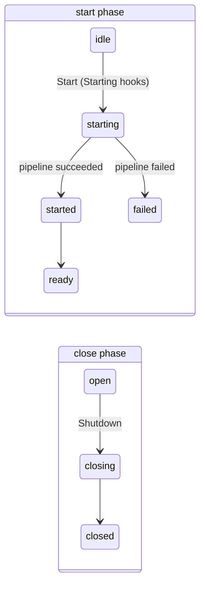

# Container hooks

Container hooks run container-wide logic once per root container: when it starts, when it is ready, when its start fails, and around its shutdown. They complement the per-service hooks (`HookBeforeStart`, `HookAfterShutdown`…), which run once per service.

| Hook                    | Signature                                 | Fires                                   |
| ----------------------- | ----------------------------------------- | --------------------------------------- |
| `HookContainerStarting` | `func(context.Context, *RootScope) error` | first `Start`, before anything is built |

Each hook list is a field of `doger.InjectorOpts`, and has a matching `RootScope.AddContainer<State>Hook` method.

## Phases {#phases}

A root container has a start phase and a close phase. Each transition happens at most once, and the hooks fire at the transitions:



The two phases are independent: a container can shut down without ever starting, or while it is starting.

## Starting {#starting}

`HookContainerStarting` hooks run on the goroutine that calls the first `Start`, after its one-shot guard and **before** its context check, discovery or any instantiation. They receive the Start-time context, which keeps the values of the context passed to `StartWithContext` and is cancelled by a root `Shutdown`.

A Starting hook can **veto** `Start` by returning an error: the remaining Starting hooks do not run, nothing is built or started, and `Start` returns an error wrapping the hook's error.

```go
root := doger.New()

root.AddContainerStartingHook(func(ctx context.Context, root *doger.RootScope) error {
    if os.Getenv("DB_URL") == "" {
        return errors.New("missing DB_URL") // fail fast: nothing is built
    }
    return nil
})

err := root.Start()
// err: DI: container start aborted: missing DB_URL
```

Because Starting hooks run before the context check, they run even when the context passed to `StartWithContext` is already cancelled. `Start` then fails with an error matching `context.Canceled`.
